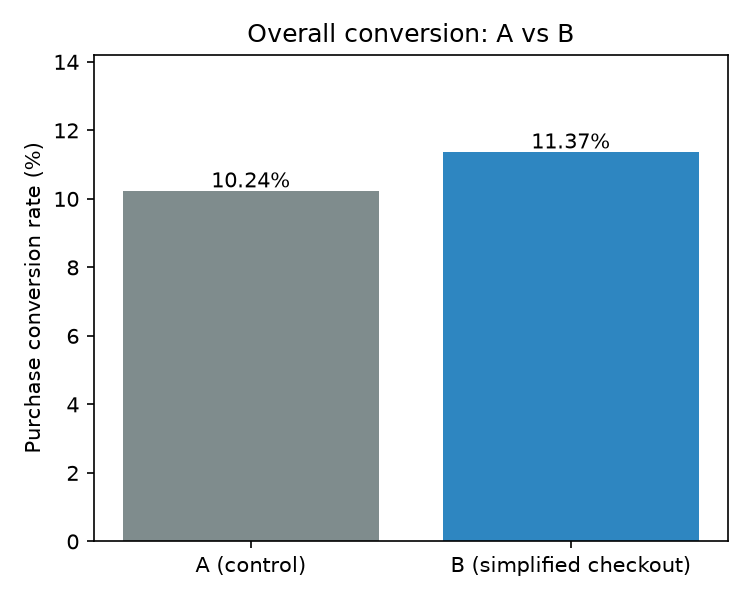
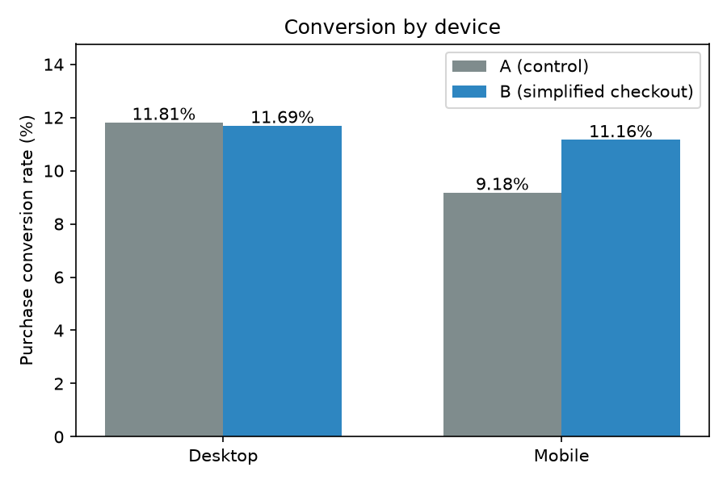
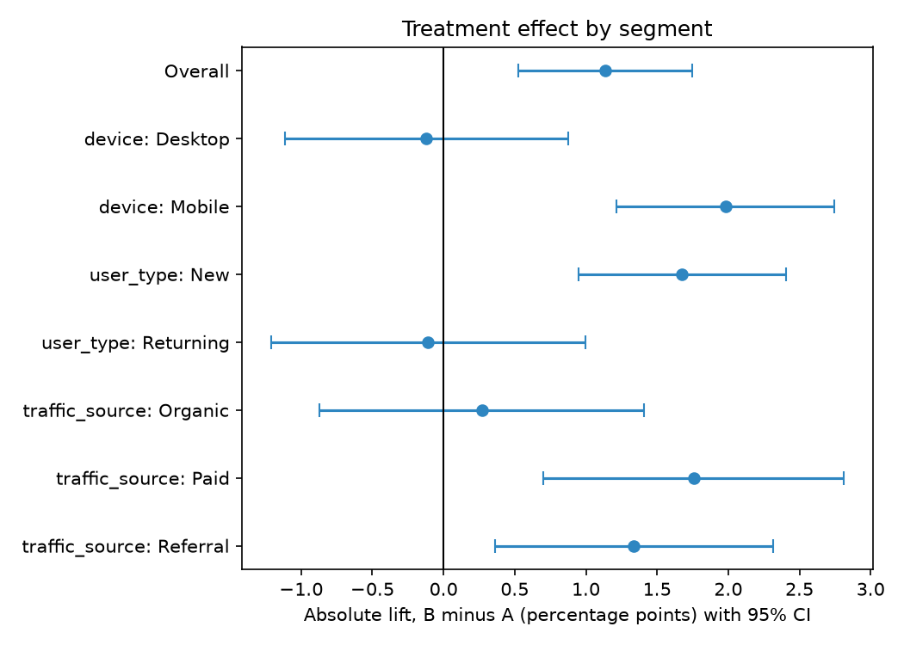

# ExperimentLab

A/B testing analytics project using C++, Python, SQL, and statistics.

We made up a checkout redesign test and built the whole pipeline around it. Python generates fake users, SQL stores them, C++ runs the statistics, and Python checks the results again at the end.

## The question

Does a simpler checkout page make more people buy?

Group A sees the old checkout and group B sees the simplified one. Users are split randomly between the two. The main thing we measure is the purchase conversion rate, which is users who bought divided by users in the group. We also look at revenue per user. The test is two-sided with alpha = 0.05. The full design is in `docs/experiment-design.md`.

## What's in the repo

- `python/generate_data.py` makes the fake users and saves them to CSV in `data/raw/`
- `python/load_db.py` puts the data in a SQLite database using `sql/schema.sql`
- `sql/queries.sql` has the metric queries, and `python/run_queries.py` runs them
- `python/analysis.py` breaks the results down by segment, double checks the stats with statsmodels, and makes the charts
- `cpp/` is the statistics engine and its tests

## The data

The data is fake. `generate_data.py` makes 40,000 users. Each one gets a device (Desktop or Mobile), a user type (New or Returning) and a traffic source (Organic, Paid or Referral). Then they're randomly put in A or B, and randomly buy or don't.

We set the buying chances ourselves so that B helps mobile users and new users more than desktop and returning users. That way there's actually something to find when we break things down. Every order is $49.99 for now, and the random seed is fixed, so you get the same data every run.

## The statistics

The C++ code calculates conversion rates, absolute and relative lift, a two-proportion z-test with a p-value, a 95% confidence interval, and sample size and power for planning a test. `analysis.py` runs the same tests with statsmodels. The numbers from both match, and the SQL queries match the C++ report too.

## Results

| | A | B | Lift | 95% CI | p-value |
|---|---|---|---|---|---|
| Conversion | 10.24% | 11.37% | +1.14 points (+11.1%) | [0.53, 1.74] | 0.00025 |
| Revenue per user | $5.12 | $5.69 | +$0.57 | | |



By segment:

| Segment | Lift (points) | Significant |
|---|---|---|
| Mobile | +1.98 | yes |
| Desktop | -0.12 | no |
| New users | +1.68 | yes |
| Returning users | -0.11 | no |
| Paid traffic | +1.76 | yes |
| Referral traffic | +1.34 | yes |
| Organic traffic | +0.27 | no |




The full table is in `docs/findings.md`.

## What we take from it

The simplified checkout works. Conversion goes from 10.24% to 11.37%, and revenue per user goes up by $0.57.

Most of that comes from mobile and new users. Desktop and returning users barely change. Our guess is the old checkout was mostly a problem on mobile and for people who hadn't bought before, so fixing it helps them and not anyone else.

A few things to keep in mind. "Not significant" for desktop and returning users doesn't mean there's no effect, it only means we can't tell with this many users. We also ran seven segment tests, so one of them could be a fluke by chance, although the biggest results have very small p-values. And since the data is fake and the price never changes, revenue only moves because conversion moves.

## Running it

Run everything from the repo root.

```
pip install -r python/requirements.txt

python python/generate_data.py
python python/load_db.py
python python/run_queries.py
python python/analysis.py

cmake -S . -B build
cmake --build build
ctest --test-dir build -C Debug --output-on-failure
```

Then run the C++ report from the repo root, since it reads `data/raw/generated_users.csv`:

- Mac/Linux: `./build/experiment`
- Windows: `.\build\Debug\experiment.exe`

The CSV and `.db` files are generated, so they aren't committed. The charts end up in `docs/images/`.
